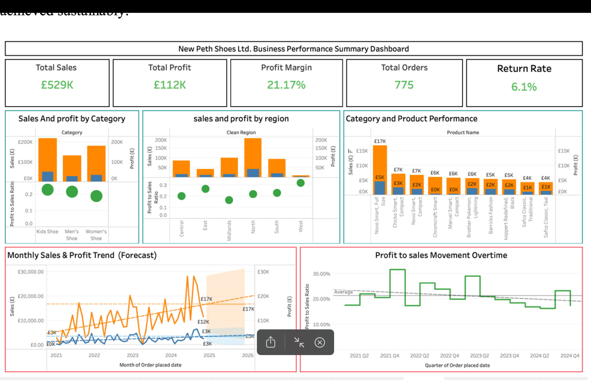
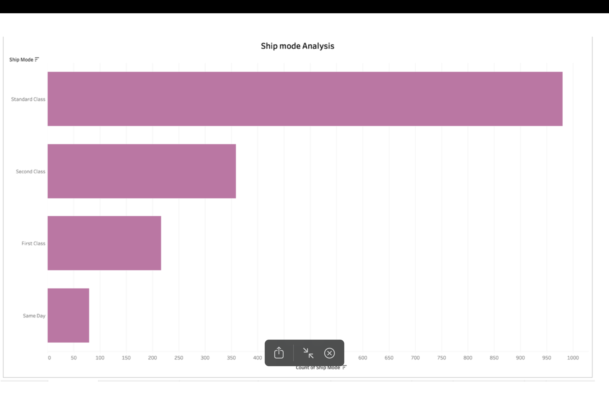
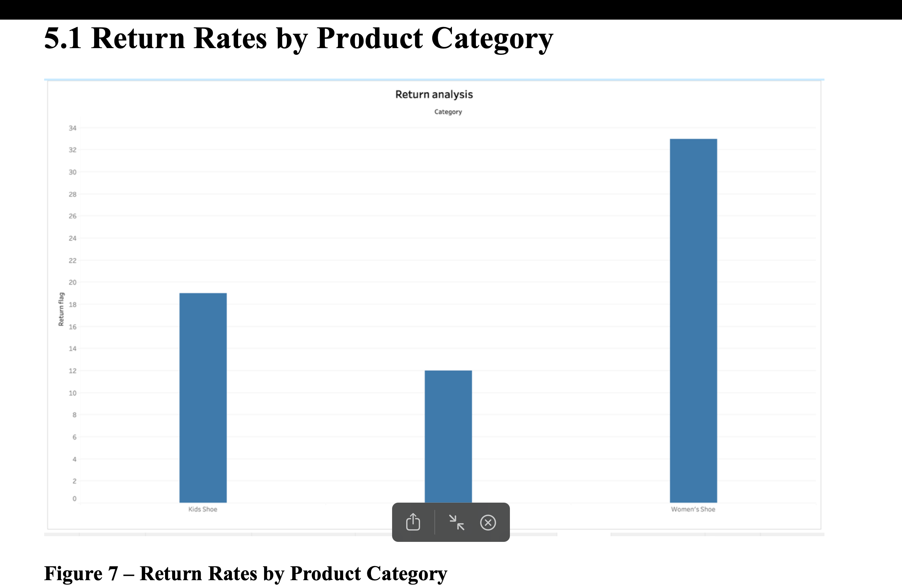
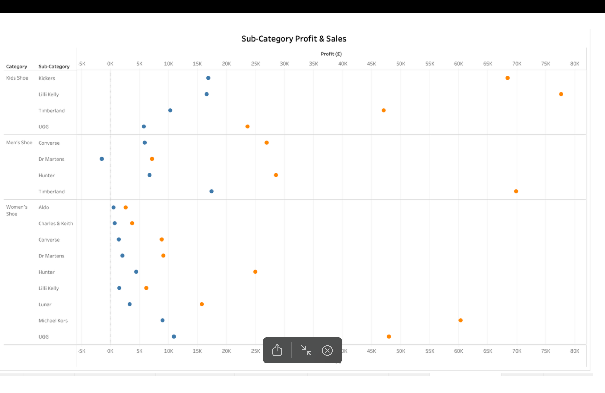

# Retail Business Performance & Profitability Analytics — New-Peth Shoes

**Tableau | Microsoft Excel | Business Intelligence | KPI Reporting**

## Overview

This project evaluates the performance of a fictional online footwear retailer, **New-Peth Shoes Ltd.**, to answer a commercial question: **Where is the business generating revenue, where are margins under pressure, and what operational decisions could improve profitability?**

The original MSc assignment developed Tableau dashboard visualisations based on a module-provided sales dataset. The analysis covers sales, profit, customer composition, product categories, fulfilment and product returns.

## Business objectives

1. Evaluate sales and profitability with decision-relevant KPIs.
2. Compare performance across product categories, household segments and regions.
3. Examine delivery methods and the distribution of late/pending fulfilment.
4. Understand where returns and discounting may place pressure on profit.
5. Form evidence-based recommendations for retail operations and growth.

## KPI snapshot from the project report

| KPI | Value reported in coursework |
|---|---:|
| Total sales | £529,000 |
| Total profit | £112,000 |
| Profit margin | 21.17% |
| Orders | 775 |
| Customers | 529 |

*These figures describe the coursework dataset, not the verified accounts of a real company.*

## Dashboard gallery

### Executive overview

### Product and profitability analysis

### Shipping and fulfilment analysis

### Returns and margin analysis

## Process and analysis

- **Excel preparation:** screened blank values, standardised regional labels, reviewed duplicate rows and checked numeric fields including discounts and negative profit.
- **Tableau metrics:** used calculated fields for profit margin, return rate and shipping-time measures.
- **Performance analysis:** compared total sales and profits by product grouping, geography, household type and time.
- **Operations analysis:** explored shipping mode, order status and geography-specific fulfilment performance.
- **Commercial recommendations:** prioritised higher-margin products, investigated return drivers and considered improvements to shipping strategy and customer targeting.

Read the full [analysis summary](documentation/analysis_summary.md).

## Main observations

- **Sales growth does not always mean proportionate profit growth.** The report highlights potential effects of discounting, returns and fulfilment costs.
- **Profitability varies across categories and customers.** Some sub-categories and family-household groups appear commercially important in the analysed data.
- **Operational issues can be geographically concentrated.** Fulfilment and return behaviour warrant more detailed location and category monitoring.

These are **observational findings**, not evidence of proven causal effects or realised business improvements.

## Repository contents

- `images/` — four selected figures or dashboard screenshots.
- [`documentation/analysis_summary.md`](documentation/analysis_summary.md) — data preparation, methods, results and recommended actions.

**Workbook availability:** The Tableau `.twb/.twbx` source used during university work is not currently available. This repository therefore documents the project through screenshots and methodological notes; it **does not claim to provide a runnable interactive Tableau dashboard**. If the workbook is recovered and sharing is permitted, it can be added later.

**Data availability:** The project used module-provided data; raw files are intentionally not included unless permission to redistribute them is confirmed.

## Skills demonstrated

Dashboarding • Commercial KPI design • Excel data validation • Tableau calculated fields • Profitability analysis • Customer segmentation by business attributes • Fulfilment analytics • Data storytelling
